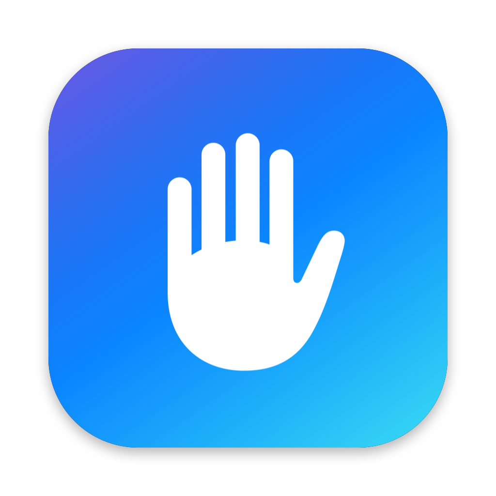
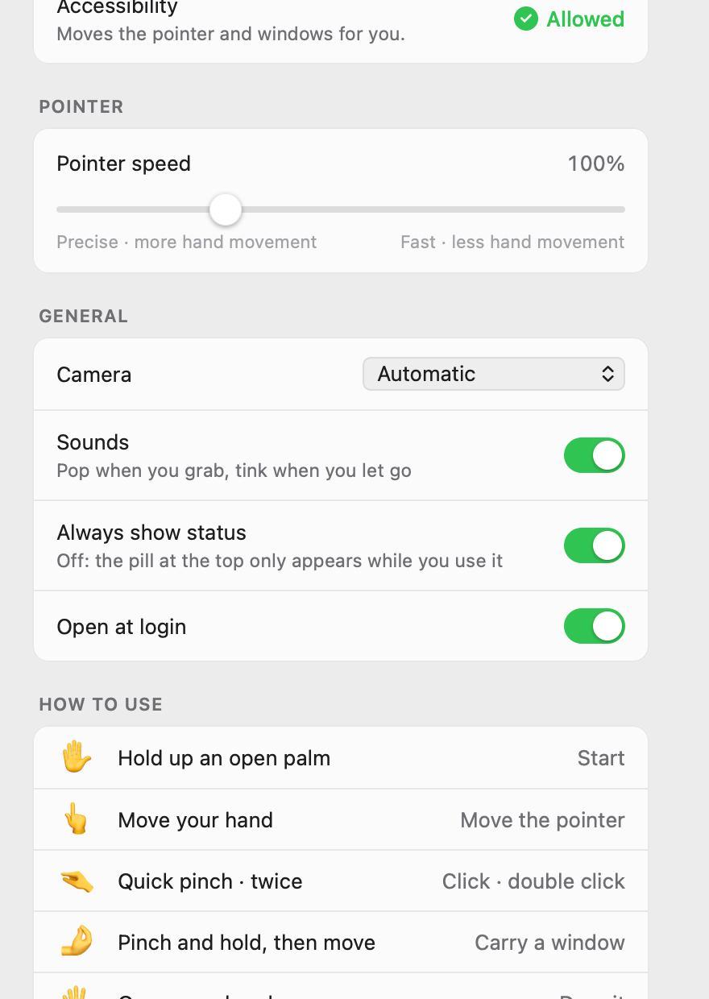

<p align="center"></p>

# Gesture Control

Grab, drag, click and minimize your Mac's windows with your bare hand, using the camera your Mac already has.
Pinch a window, carry it across all your screens, open your hand to drop it.

<p align="center">
  <b>macOS 12 or newer</b> · Apple Silicon and Intel · free and open source
</p>

## Install (1 minute)

Open **Terminal** (press ⌘ Space, type *Terminal*, press Enter), paste this line and press Enter:

```bash
curl -fsSL https://raw.githubusercontent.com/Max-1902/gesture-control/main/install.sh | bash
```

It downloads the app into Applications and opens it. Then:

1. **Allow Camera** when macOS asks.
2. **Allow Accessibility:** click *Open System Settings* in the message that appears (or *Allow…* in the
   Gesture Control window) and switch on **Gesture Control**. This lets it move the pointer and windows.
3. **Hold up an open palm** toward the camera for a moment. A ring fills up, and you're in control.

That's it. The ✋ in the menu bar has **Settings** and **Quit**.

<details>
<summary>Prefer a normal download instead of Terminal?</summary>

Download [Apple Silicon (M1 or newer)](https://github.com/Max-1902/gesture-control/releases/latest/download/Gesture-Control-mac-arm64.zip)
or [Intel](https://github.com/Max-1902/gesture-control/releases/latest/download/Gesture-Control-mac-intel.zip)
(not sure? Apple menu → *About This Mac*: "Chip: Apple M…" means Apple Silicon). Open the zip and drag
**Gesture Control** into Applications.

The app isn't from the App Store, so the first time you open it macOS refuses with a warning. Click **Done**, then go
to **System Settings → Privacy & Security**, scroll down and click **Open Anyway**. You only need to do this once.
</details>

## How to use it

| Do this | What happens |
|---|---|
| ✋ Hold up an **open palm** (about 1 second) | Start. A small pill at the top of the screen shows the state |
| 👆 Move your hand | Move the pointer. Small movements are enough |
| 🤏 **Quick pinch** (thumb + index finger) | Click. Pinch twice for a double click |
| 🤌 **Pinch and hold**, then move | Pick up the window under the pointer and carry it |
| 🖐 Open your hand | Drop the window |
| ✊ **Tight fist** for 1 second | Minimize the window under the pointer |
| 🙌 Pinch with **both hands**, spread apart or together | Resize the window |
| 👇 Lower your hand for 3 seconds | Pause (hold up your palm again to continue) |

**⌃⌥⌘G** (Control + Option + Command + G) turns it on and off from anywhere. While it's off, the camera is off too.

Tips: sit so the camera sees your whole hand, a little above the bottom edge of the picture (the pill tells you when
your hand is too low). Nothing happens while you type or talk; it only reacts after you show an open palm.

## Settings



Click ✋ in the menu bar → **Settings…**

- **Pointer speed:** higher means less hand movement to cross your screens.
- **Camera:** pick an external camera if you have one.
- **Sounds**, **Always show status** and **Open at login**.
- Shows whether Camera and Accessibility are allowed, with a button to fix it if not.

<br clear="right">

## Privacy

Hand tracking runs entirely on your Mac with Apple's built-in Vision framework. Video is never saved or sent anywhere,
and the app has no accounts, analytics or network access. Settings live in
`~/Library/Application Support/Gesture Control`, a small log in `~/Library/Logs/Gesture Control`.

## Troubleshooting

- **The pointer doesn't move, but the pill reacts:** Accessibility isn't allowed. Open Settings from the menu bar
  icon and click *Allow…*. If Gesture Control is already switched on in that list, switch it off and on again.
- **"Waiting for camera access":** System Settings → Privacy & Security → Camera → switch on Gesture Control.
- **It doesn't start:** make sure your hand is fully in view and not too close to the bottom edge of the picture,
  and that no other app (FaceTime, Zoom) is using the camera.
- **Uninstall:** quit it from the menu bar, drag *Gesture Control* from Applications to the Trash, and optionally delete
  the two folders listed under Privacy.

## For developers

Everything is Python (PyObjC for the macOS parts). Run from source:

```sh
git clone https://github.com/Max-1902/gesture-control.git && cd gesture-control
scripts/dev-setup.sh                      # venv + dependencies + a `gesture-control` command
gesture-control                           # run (macOS asks Camera/Accessibility for your Terminal)
gesture-control --preview                 # with a camera debug window
gesture-control --dry-run                 # track and log, never touch the mouse or windows
.venv/bin/python -m pytest -q src/tests   # tests
packaging/build_app.sh [x86_64]           # build the .app + release zip (needs uv)
```

From source, every run keeps a landmark recording (no images) in `recordings/live/` and logs to `logs/run.log`, so a
bug can be replayed and turned into a test: `python src/replay.py recordings/live/<file>.jsonl`.
All tuning lives in [`config/default.yaml`](config/default.yaml). Design notes: [docs/architecture.md](docs/architecture.md).

| File | Role |
|------|------|
| `src/av_source.py` | Camera capture → Apple Vision hand pose |
| `src/identity.py`, `one_euro.py` | Stable left/right hand identity, jitter filter |
| `src/features.py` | Scale-invariant hand features (pinch, curl, openness, ...) |
| `src/fsm.py` | Gesture state machine: start, click, drag, minimize, resize |
| `src/router.py` | Pointer (own thread) and window control via Accessibility (own thread) |
| `src/overlay.py`, `src/ui/settings.html` | UI process: on-screen HUD, menu bar icon, settings window, hotkey |
| `src/run.py` | Main app: camera, permissions, settings, main loop |

## License

MIT
